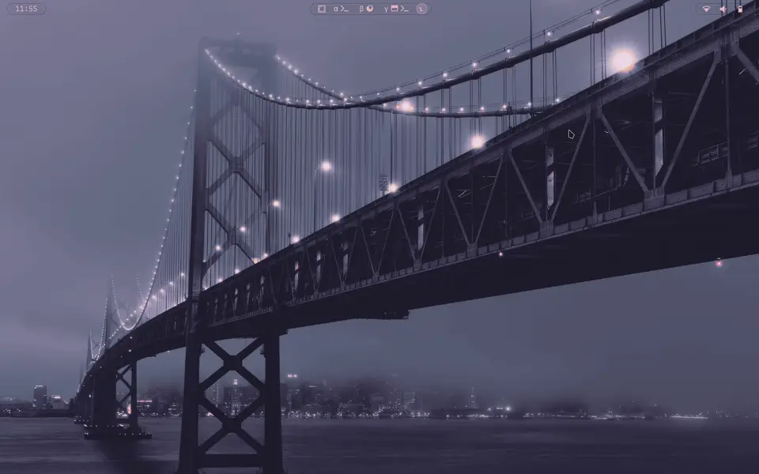

# Omarchy Wallpaper FX

[🇷🇺 Русский](README.ru.md)

24 wallpaper transitions for [Omarchy](https://omarchy.org), all drawn by a single custom fragment shader.
A clone of the stock `omarchy.background`: click handling and everything else stay the same, only the
transition between wallpapers is new.



`slant` (stock), `fade`, `wipe`, `wave`, `grow`, `outer`, `diamond`, `clock`, `blinds`, `doors`, `mosaic`,
`dissolve`, `pixelize`, `ripple`, `swirl`, `crosszoom`, `slide`, `zoom`, `glitch`, `burn`, `waterdrop`,
`hexagon`, `random`, `none`. Own implementations of ideas from swww and gl-transitions.

## Install

```sh
omarchy plugin add https://github.com/KamradSmeshnyavy/omarchy-wallpaper-fx --enable
omarchy restart shell
echo '{"type": "grow", "duration": 1200, "easing": "InOutCubic", "origin": "cursor"}' \
  > ~/.config/omarchy/wallpaper-transition.json
```

Change the wallpaper as usual (`omarchy-theme-bg-next`, the background switcher, a theme change). Replay
the current effect without changing anything:

```sh
omarchy-shell background replay
```

Back to the stock background: `omarchy plugin enable omarchy.background`.

Tested on Omarchy 4.0.6 with Quickshell 0.3.2.

## Settings — `~/.config/omarchy/wallpaper-transition.json`

Read on the fly.

| Key | Default | |
|---|---|---|
| `type` | `slant` | effect |
| `duration` | `420` | ms |
| `easing` | `InOutCubic` | a Qt easing curve: InOutQuad, OutExpo, OutBack, OutBounce, Linear, … |
| `angle` | `0` | degrees, for wipe / wave / slide |
| `origin` | `center` | where circles and the water drop start: center / cursor / random |
| `softness` | `0.02` | width of the soft edge |

## Hacking the shader

`shaders/transition.frag` holds every effect (selected by `mode`); `TransitionEffect.qml` feeds it. After
editing, rebuild the compiled shader (both files are committed):

```sh
/usr/lib/qt6/bin/qsb --glsl "100 es,120,150" --hlsl 50 --msl 12 -O \
  -o shaders/transition.frag.qsb shaders/transition.frag
```

Changes against the stock `Background.qml` are marked `// fx:`.

In [my dotfiles](https://github.com/KamradSmeshnyavy/dotfiles) the effect and its settings are picked in
the Customizer overlay (Wallpaper FX, `p` replays).

## With the Customizer

[omarchy-customizer](https://github.com/KamradSmeshnyavy/omarchy-customizer) is one overlay (Super+Shift+T) with live preview for this plugin's settings and
the rest of the look & feel: themes, wallpapers, Hyprland animations, transparency, blur, screen shaders.
One command installs it and offers this plugin and the others:

```sh
curl -fsSL https://raw.githubusercontent.com/KamradSmeshnyavy/omarchy-customizer/main/install.sh | bash
```

## License

MIT. Based on `omarchy.background` from [Omarchy](https://github.com/basecamp/omarchy) (MIT, © David
Heinemeier Hansson).
