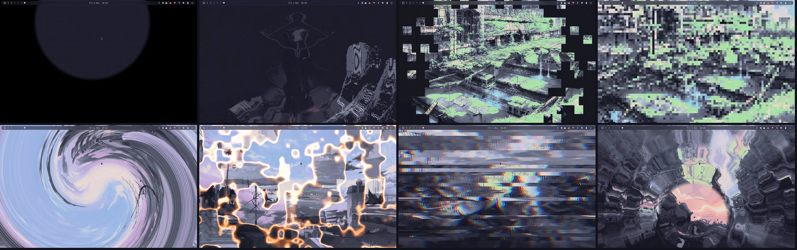

# Omarchy Wallpaper FX

[🇷🇺 Русский](README.ru.md)

26 wallpaper transitions for [Omarchy](https://omarchy.org), all drawn by a single custom fragment shader.
A clone of the stock `omarchy.background`: click handling and everything else stay the same, only the
transition between wallpapers is new.



<!-- Demo video: repo-videos/omarchy-wallpaper-fx.mp4 — drag it here when editing this file on GitHub -->

`slant` (stock), `fade`, `wipe`, `wave`, `grow`, `outer`, `diamond`, `clock`, `blinds`, `doors`, `mosaic`,
`dissolve`, `pixelize`, `ripple`, `swirl`, `crosszoom`, `slide`, `zoom`, `glitch`, `burn`, `waterdrop`,
`hexagon`, `hexreveal`, `contagion`, `outline`, `outline-cut`, `random`, `none`. Own implementations of ideas from swww and gl-transitions; `hexreveal` (honeycomb cells each opening from their own middle in a wave from `origin`, with a lit rim) is ported from Vitreus' `wptrans/hexreveal.wgsl` (MIT, © natepayn3).

### Scene transitions: `contagion` and `outline`

Two slower effects (`durationScene`, 1.9 s by default) after the transitions of
[diegoMalagrida/pocket-dots](https://github.com/diegoMalagrida/pocket-dots). The idea is theirs, the code here is new.

- **contagion**: pixel colonies land at random places and eat through the old wallpaper along ragged
  fronts. A freshly flipped cell flashes in the brightest colour of the new theme, a thin glow rides the
  front, and now and then a spark jumps ahead of it. It is fully procedural, with no maps and no Python.
- **outline**: the scene steps back, and thin lines trace the picture's own edges (Canny, built in under a
  second), drawn with pens: light on dark parts of the picture, dark on light ones. Then the world grows out of
  the lines. It is light: no model and no background work.
- **outline-cut**: outline with a cut-out. The line draws the character's outline with two pens from the top,
  the character fills in from it, then the world grows out of it. The character is cut out once per wallpaper
  by [BiRefNet](https://github.com/ZhengPeng7/BiRefNet) (onnxruntime) in the background. Until then, or when
  there is no clear character, it plays like `outline`.

```sh
scripts/wallpaper-fx-outline install   # venv in ~/.local/share/wallpaper-fx + BiRefNet-lite (~220 MB)
scripts/wallpaper-fx-outline warm      # queue the current theme's wallpapers for cut-out
scripts/wallpaper-fx-outline status    # device, queue, worker, cache
```

`map` (called by the plugin on each change) answers at once: the character map if there is one, otherwise the
edge map, and the wallpaper joins the cut-out queue. The queue is handled by **one** background worker for the
whole system (flock), at `nice 19` / `ionice idle`, which loads the model once. It runs on the Intel **NPU**,
then the **GPU**, then the CPU (2 threads), whichever works first. NPU and GPU need
`sudo pacman -S intel-npu-driver intel-compute-runtime level-zero-loader`. On the CPU, a cut-out takes about 10 s
and peaks at about 6 GB of RAM, because the model input is a fixed 1024².

## Install

```sh
omarchy plugin add https://github.com/KamradSmeshnyavy/omarchy-wallpaper-fx --enable
omarchy restart shell
echo '{"type": "grow", "duration": 1200, "easing": "InOutCubic", "origin": "cursor"}' \
  > ~/.config/omarchy/wallpaper-transition.json
```

Change the wallpaper as usual (`omarchy-theme-bg-next`, the background switcher, a theme change). Replay
the current effect without changing anything:

```sh
omarchy-shell background replay
```

Back to the stock background: `omarchy plugin enable omarchy.background`.


## Requirements

Omarchy 4 (Quattro) with its shell. Tested on Omarchy 4.0.6 with Quickshell 0.3.2.

- Nothing beyond Omarchy: the transitions are a single GLSL shader run by Quickshell.
- `outline` only: `opencv` + `numpy` for the edge maps (system python or the venv); the cut-out venv is optional.

### Live wallpapers (owe)

Video and GIF wallpapers are played by owe (the `owe` package), not by this plugin; owe hides the shell's wallpaper
through `setSuspended`, as it does with the stock plugin. Transitions still play, outline-cut included:
`scripts/wallpaper-fx-still` gives two stills — the frame owe is showing right now (its `time_pos`) when leaving a video
and the first frame of the new video when entering one — the effect runs between them and the layer stays up until it
ends (then owe's video, started from that same first frame, is underneath). After a shell restart the plugin asks
`owe status` itself, so the still wallpaper never covers a playing video. Older versions of this plugin lacked `setSuspended`, so owe fell back to toggling `omarchy.background`, and
that pushed the clone out of `shell.json`. As a safety net, `systemd/wallpaper-fx-keep.{path,service}` re-enables the
clone if that ever happens again. It acts only right after an owe "shell background enabled" event, so it never undoes
a manual switch. It is optional: link it into `~/.config/systemd/user/` and run
`systemctl --user enable --now wallpaper-fx-keep.path`. Turn it off with `"keepAfterOwe": false`.

## Uninstall

```sh
omarchy plugin enable omarchy.background      # switch back to the stock one first
omarchy plugin remove kamradsmeshnyavy.background
omarchy restart shell
```

Your settings stay in `~/.config/omarchy/wallpaper-transition.json` — delete them by hand if you don't need them.

## Settings — `~/.config/omarchy/wallpaper-transition.json`

Read on the fly.

| Key | Default | |
|---|---|---|
| `type` | `slant` | effect |
| `duration` | `420` | ms |
| `easing` | `InOutCubic` | a Qt easing curve: InOutQuad, OutExpo, OutBack, OutBounce, Linear, … |
| `angle` | `0` | degrees, for wipe / wave / slide |
| `origin` | `center` | where circles and the water drop start: center / cursor / random |
| `softness` | `0.02` | width of the soft edge |
| `durationScene` | `1900` | ms, for contagion / outline (they always run linearly; their curves are in the shader) |
| `cell` | `6` | px, size of the contagion / outline cells |
| `frontGlow` | `0.9` | 0..1, contagion flashes and front glow |
| `lineWidth` | `1.5` | px, outline line |
| `outlineWait` | `3000` | ms to wait for the map before falling back to contagion (normally under a second) |

## Hacking the shader

`shaders/transition.frag` holds every effect (selected by `mode`); `TransitionEffect.qml` feeds it. After
editing, rebuild the compiled shader (both files are committed):

```sh
/usr/lib/qt6/bin/qsb --glsl "100 es,120,150" --hlsl 50 --msl 12 -O \
  -o shaders/transition.frag.qsb shaders/transition.frag
```

Changes against the stock `Background.qml` are marked `// fx:`.

In [my dotfiles](https://github.com/KamradSmeshnyavy/dotfiles) the effect and its settings are picked in
the Customizer overlay (Wallpaper FX, `p` replays).

## With the Customizer

[omarchy-customizer](https://github.com/KamradSmeshnyavy/omarchy-customizer) is one overlay (Super+Shift+T) with live preview for this plugin's settings and
the rest of the look & feel: themes, wallpapers, Hyprland animations, transparency, blur, screen shaders.
Install it next to this plugin (it finds the other companions on its own):

```sh
omarchy plugin add https://github.com/KamradSmeshnyavy/omarchy-customizer --enable
```

## License

MIT. Based on `omarchy.background` from [Omarchy](https://github.com/basecamp/omarchy) (MIT, © David
Heinemeier Hansson). The `contagion` / `outline` transitions are inspired by
[pocket-dots](https://github.com/diegoMalagrida/pocket-dots) (GPL-3.0); no code was taken from it.
