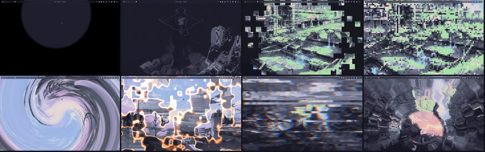

# Omarchy Wallpaper FX

[🇬🇧 English](README.md)

26 переходов обоев для [Omarchy](https://omarchy.org) на одном своём фрагментном шейдере. Клон стокового
`omarchy.background`: клики и всё остальное как в стоке, новый только переход между обоями.



<!-- Demo video: repo-videos/omarchy-wallpaper-fx.mp4 — drag it here when editing this file on GitHub -->

`slant` (сток), `fade`, `wipe`, `wave`, `grow`, `outer`, `diamond`, `clock`, `blinds`, `doors`, `mosaic`,
`dissolve`, `pixelize`, `ripple`, `swirl`, `crosszoom`, `slide`, `zoom`, `glitch`, `burn`, `waterdrop`,
`hexagon`, `contagion`, `outline`, `random`, `none`. Свои реализации по идеям swww и gl-transitions.

### Переходы-сцены: `contagion` и `outline`

Два неторопливых эффекта (`durationScene`, по умолчанию 1,9 с) по мотивам переходов
[diegoMalagrida/pocket-dots](https://github.com/diegoMalagrida/pocket-dots). Идея — оттуда, код написан заново.

- **contagion**: колонии пикселей появляются в случайных местах и прогрызают старые обои по рваному
  фронту. Только что перевёрнутая клетка вспыхивает самым ярким цветом новой темы, вдоль фронта идёт
  тонкое свечение, изредка впереди проскакивает искра. Полностью процедурный: ни карт, ни Python.
- **outline**: для обоев с персонажем. Сцена отступает, тонкая линия самым светлым цветом темы рисует
  контур персонажа (два пера от верхней точки), персонаж заливается от линии, потом из него вырастает
  остальной мир. Персонажа один раз на обои вырезает [BiRefNet](https://github.com/ZhengPeng7/BiRefNet)
  через [rembg](https://github.com/danielgatis/rembg), карты лежат в `~/.cache/wallpaper-fx/outline/`. Без модели
  или без явного персонажа переход играет как `contagion`.

```sh
scripts/wallpaper-fx-outline install   # venv в ~/.local/share/wallpaper-fx (~1 ГБ вместе с моделью)
scripts/wallpaper-fx-outline warm      # заранее вырезать обои текущей темы
scripts/wallpaper-fx-outline status
```

Первая смена на ещё не вырезанные обои ждёт вырезку (`outlineWait`, 8 с), а если не дождалась, играет
contagion. После перехода, которому пришлось ждать вырезку, остальные обои этой папки дорезаются в фоне.

## Установка

```sh
omarchy plugin add https://github.com/KamradSmeshnyavy/omarchy-wallpaper-fx --enable
omarchy restart shell
echo '{"type": "grow", "duration": 1200, "easing": "InOutCubic", "origin": "cursor"}' \
  > ~/.config/omarchy/wallpaper-transition.json
```

Обои меняются как обычно (`omarchy-theme-bg-next`, переключатель обоев, смена темы). Проиграть текущий
эффект ещё раз:

```sh
omarchy-shell background replay
```

Вернуть стоковый фон: `omarchy plugin enable omarchy.background`.


## Требования

Omarchy 4 (Quattro) с его оболочкой. Проверено на Omarchy 4.0.6 и Quickshell 0.3.2.

- Ничего, кроме Omarchy: переходы — один GLSL-шейдер в Quickshell.
- Только для `outline`: `uv` и ~1 ГБ на venv вырезки (по желанию, см. выше).

## Удаление

```sh
omarchy plugin enable omarchy.background      # сначала вернуть стоковый
omarchy plugin remove kamradsmeshnyavy.background
omarchy restart shell
```

Настройки остаются в `~/.config/omarchy/wallpaper-transition.json` — удалите их вручную, если не нужны.

## Настройки — `~/.config/omarchy/wallpaper-transition.json`

Читается на лету.

| Ключ | Умолч. | |
|---|---|---|
| `type` | `slant` | эффект |
| `duration` | `420` | мс |
| `easing` | `InOutCubic` | кривая Qt: InOutQuad, OutExpo, OutBack, OutBounce, Linear, … |
| `angle` | `0` | градусы для wipe / wave / slide |
| `origin` | `center` | откуда круг и капля: center / cursor / random |
| `softness` | `0.02` | ширина мягкого края |
| `durationScene` | `1900` | мс, для contagion / outline (они всегда идут линейно, кривые — в шейдере) |
| `cell` | `6` | px, размер клеток contagion / outline |
| `frontGlow` | `0.9` | 0..1, вспышки и свечение фронта contagion |
| `lineWidth` | `1.5` | px, линия outline |
| `outlineWait` | `8000` | мс ожидания свежей вырезки, потом contagion |

## Правка шейдера

Все эффекты — в `shaders/transition.frag` (номер — `mode`), подаёт его `TransitionEffect.qml`. После правки
пересобрать скомпилированный шейдер (в репо лежат оба файла):

```sh
/usr/lib/qt6/bin/qsb --glsl "100 es,120,150" --hlsl 50 --msl 12 -O \
  -o shaders/transition.frag.qsb shaders/transition.frag
```

Правки стокового `Background.qml` помечены `// fx:`.

В [моих dotfiles](https://github.com/KamradSmeshnyavy/dotfiles) эффект и настройки выбираются в оверлее
Customizer (Wallpaper FX, `p` — проиграть).

## Вместе с Customizer

[omarchy-customizer](https://github.com/KamradSmeshnyavy/omarchy-customizer) — один оверлей (Super+Shift+T) с живым предпросмотром для настроек этого
плагина и всего остального оформления: темы, обои, анимации Hyprland, прозрачность, блюр, шейдеры экрана.
Поставьте его рядом с этим плагином (остальные компаньоны он найдёт сам):

```sh
omarchy plugin add https://github.com/KamradSmeshnyavy/omarchy-customizer --enable
```

## Лицензия

MIT. Основано на `omarchy.background` из [Omarchy](https://github.com/basecamp/omarchy) (MIT, © David
Heinemeier Hansson). Переходы `contagion` / `outline` — по мотивам
[pocket-dots](https://github.com/diegoMalagrida/pocket-dots) (GPL-3.0); код оттуда не брался.
